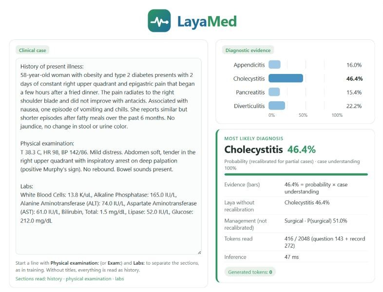
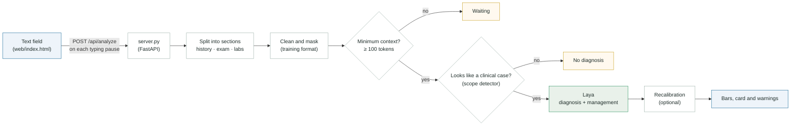

<picture>
  <source media="(prefers-color-scheme: dark)" srcset="assets/banner-dark.svg">
  
</picture>

<p align="center">
  <a href="https://colab.research.google.com/github/csbl-usp/LayaMed/blob/main/notebooks/layamed_colab.ipynb"></a>
  <a href="https://github.com/csbl-usp/LayaMed/actions/workflows/tests.yml"></a>
  <a href="LICENSE"></a>
  
  
</p>

<p align="center">
  <a href="#-quick-start"><b>Quick start</b></a> ·
  <a href="#-step-by-step-guide"><b>Guide</b></a> ·
  <a href="#-how-it-works"><b>How it works</b></a> ·
  <a href="docs/09-limitations.md"><b>Limitations</b></a>
</p>

LayaMed shows, **while you write a clinical case**, the probabilities of a Laya model fine-tuned on 4 acute abdominal diseases: appendicitis, cholecystitis, pancreatitis and diverticulitis. This repository is a **step-by-step guide** to build it from scratch, with a complete Colab example on **synthetic cases** (generated by rules, no patient data at all).

> [!WARNING]
> **Not a medical device.** The example uses synthetic cases and a teaching management label: the numbers have no clinical value.

## ✨ Highlights

<table>
  <tr>
    <td width="25%" valign="top" align="center">
      <br>
      <b>Live while typing</b><br>
      <sub>An encoder reads the whole case in ~50 ms on a laptop GPU, so the bars update on every pause.</sub>
    </td>
    <td width="25%" valign="top" align="center">
      <br>
      <b>Out-of-scope guard</b><br>
      <sub>Text that does not look like a clinical case gets no probability instead of a forced diagnosis.</sub>
    </td>
    <td width="25%" valign="top" align="center">
      <br>
      <b>Calibrated as you write</b><br>
      <sub>Probabilities stay moderate while the case is incomplete and grow with history, exam and labs.</sub>
    </td>
    <td width="25%" valign="top" align="center">
      <br>
      <b>Runs locally</b><br>
      <sub>Plain HTML page and a FastAPI server on your machine; no CDN, nothing leaves it.</sub>
    </td>
  </tr>
</table>

## 🖥️ The interface

<p align="center">
  
</p>

<p align="center"><sub>Write history, exam and labs in a single field; the bars, the diagnosis card and the warnings follow along.<br>Light and dark themes follow the system setting.</sub></p>

## 🔍 How it works



Laya does not generate text: it is an encoder (mmBERT, 322 M parameters) that reads the question, the options and the record in a single sequence and returns one probability per option.

## 🚀 Quick start

<table>
  <tr>
    <th width="50%">On Colab (recommended to start)</th>
    <th width="50%">On your computer</th>
  </tr>
  <tr>
    <td valign="top">

1. Open the notebook: [](https://colab.research.google.com/github/csbl-usp/LayaMed/blob/main/notebooks/layamed_colab.ipynb)
2. `Runtime → Change runtime type → GPU`
3. Run the cells in order: it trains on synthetic cases and opens the interface inside Colab (~30 min on a T4).

</td>
    <td valign="top">

Follow [Environment](docs/01-environment.md) and [Run locally](docs/08-run-locally.md). With the trained checkpoint in `checkpoint/`:

```bash
conda activate layamed
python server.py
```

Then open <http://127.0.0.1:8000>.

</td>
  </tr>
</table>

## 📚 Step-by-step guide

| Step | Document | What you do |
|---|---|---|
| 0 | [Overview](docs/00-overview.md) | Understand the pieces and the path from a text to a probability |
| 1 | [Environment](docs/01-environment.md) | Install Python, PyTorch with CUDA and `laya==0.4.7` (local), or use Colab |
| 2 | [Data](docs/02-data.md) | Input format, cleaning, synthetic cases and how to use your own data |
| 3 | [Fine-tuning](docs/03-fine-tuning.md) | Train Laya on the diagnosis and management questions |
| 4 | [Inference](docs/04-inference.md) | Load the checkpoint and get probabilities in Python |
| 5 | [Scope and recalibration](docs/05-scope-and-recalibration.md) | Block probabilities for non-clinical text; moderate incomplete cases |
| 6 | [Service and server](docs/06-server.md) | `layamed/service.py` and the FastAPI API |
| 7 | [Interface](docs/07-interface.md) | How `web/index.html` is built: single field, bars, animated typing |
| 8 | [Run on your computer](docs/08-run-locally.md) | Local server and access from your home or lab network |
| 9 | [Limitations](docs/09-limitations.md) | What the model does not do, privacy and licenses |

## 🗂️ Repository structure

<details>
<summary>Files and folders</summary>

```
LayaMed/
├── README.md
├── server.py                    FastAPI server (page + API)
├── web/index.html               interface (plain HTML, CSS and JavaScript, no CDN)
├── assets/laya_logo.svg         logo
├── layamed/
│   ├── inference.py             input format, text cleaning, model loading, tokens
│   ├── scope.py                 out-of-scope detector
│   ├── recalibration.py         recalibration by the amount of text written
│   └── service.py               full analysis of a case (used by the server)
├── synthetic/
│   ├── generate_cases.py        synthetic cases of the 4 diseases (complete and partial)
│   └── out_of_scope.py          non-medical and other-disease texts, to test the detector
├── notebooks/layamed_colab.ipynb   complete Colab example
├── tools/capture_demo.py        screenshots and demo GIF of the interface, for this README
├── docs/                        step-by-step guide
├── tests/                       tests without GPU (python -m pytest)
├── requirements.txt             tested versions
└── requirements-dev.txt         what the tests need
```

Generated files (kept out of git, see `.gitignore`): `checkpoint/` (trained weights), `data/scope.pt`, `data/recalibration.json`, `data/synthetic/`, `reports/`.

</details>

**Tests** (text cleaning, synthetic cases, recalibration; no GPU or model needed): `python -m pip install -r requirements-dev.txt` and `python -m pytest`. They also run on GitHub Actions on every push.

## 🧬 Origin

LayaMed started as a proof of concept of a study that compared fine-tuned Laya with LLMs on the MIMIC-IV-Ext-CDM benchmark (2,400 cases, 4 classes). MIMIC data are restricted (PhysioNet DUA): **no data, weights or artifacts derived from MIMIC are in this repository**. The code is the same; the example data are synthetic.

The base model is [Laya Multilingual](https://huggingface.co/convaiinnovations/laya) (`convaiinnovations/laya`, `multilingual` folder). Check the base model license before redistributing weights trained from it.

---

<p align="center">
  <br>
  <sub>Made at the <b>Computational Systems Biology Laboratory (CSBL-USP)</b> · <a href="LICENSE">MIT license</a></sub>
</p>
